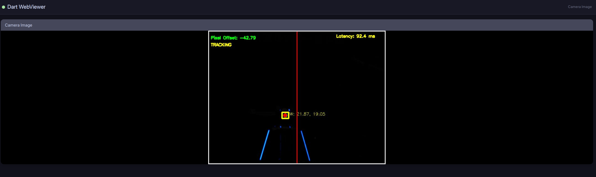
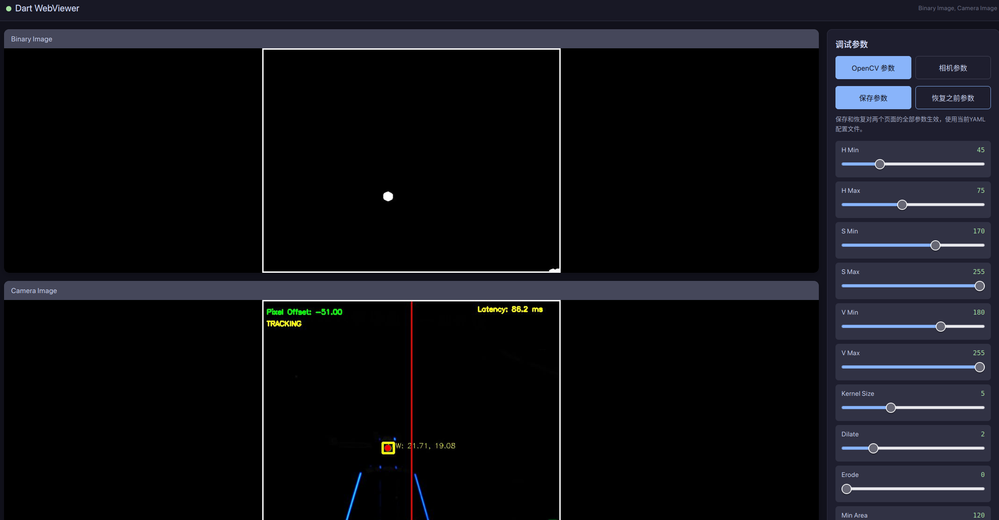
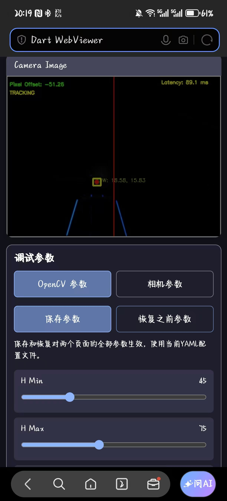

# 基于sp_vision框架镖架制导

## 实现内容
- [x] opencv稳定识别绿灯并发送像素差
- [x] 可用神经网络稳定识别绿灯
- [x] 在网页端显示可视化内容
- [x] 在网页端动态调试opencv参数
- [x] 录制相机原始图像
- [x] 可对录制好的视频进行实时识别，动态调参
- [x] 加入跟踪器，避免其它物体干扰

## 方案一：在ubuntu原生环境下部署项目
## 环境配置
理论上sp_vision能跑这个就能跑
##  编译
```bash
cmake -B build
make -C build/ -j 4  # 16个cpu大核：8  8个cpu大核：4
```
## 运行
```bash
./build/standard
```

## 方案二：使用docker快速部署项目
- step1 拉取做好的镜像
```bash
docker pull woberr/qidian:dart_arm64v8_2
```

- step2 构建容器
```bash
docker compose up -d
```

- step3 进入容器终端
```bash
docker exec -it rv_dart_ bash
```

- step4 在容器环境内编译运行（此部分已写，略）

## docker自启动
- step1 在`docker-compose.yaml`里改成：
```yaml
    # 启动命令 (对应最后那一串)
    # 进终端
    # command: -c "sleep infinity"
    # 自启动
    command: -c "source /dart_ws/dart_watch_dog.sh" 
```
- step2 构建容器（此部分已写，略）

- 自启动运行时，若要让已更改的`test.yaml`参数重新生效，需在终端执行
```bash
pkill -9 -f "standard"
```

## 开启目标设备 Wi-Fi 热点（可选）

### 安装依赖
```bash
sudo apt-get update
sudo apt install hostapd isc-dhcp-server
```
### 修改脚本

编辑 `hotspot_setup.sh` 中的参数配置：

| 参数 | 默认值 | 说明 |
| --- | --- | --- |
| `WLAN_MAC` | `f8:54:f6:c0:6b:6e` | 目标无线网卡的永久MAC，在目标设备输入`ip link show`查看`wlan0`对应MAC |
| `SSID` | `RK3588` | 手机搜索到的热点名称 |
| `PASSPHRASE` | `qidianrk3588` | 热点密码 |
| `HW_MODE` | `a` | 5 GHz 信道 36；改为 `g` 使用 2.4 GHz 信道 6 |
| `HOTSPOT_IP` | `192.168.4.1` | 热点地址，DHCP 网段随之生成 |

### 运行配置脚本
```bash
chmod +x hotspot_setup.sh
sudo bash hotspot_setup.sh
```

## 网页端窗口显示视频流

> 向网页端推送视频流解决了传统的`X11`转发环境依赖高、画面卡顿、自启动时主程序崩溃问题，是特别实用的功能

### 将当前主机与目标设备设置在同一个局域网
#### Wi-Fi 热点无线连接（适用手机、平板）

1. （可选）若目标设备未配置热点，按照“开启目标设备wifi热点”一节配置。
2. 在手机或平板上连接该热点，热点名称和密码以 `hotspot_setup.sh` 中的 `SSID`、`PASSPHRASE` 为准。默认当前设备`SSID`:**RK3588** `PASSPHRASE`：**qidianrk3588**
3. 打开浏览器，默认访问地址 `http://192.168.4.1:8080`。该地址对应`HOTSPOT_IP`

#### 网线有线连接（适用笔记本）

1. 用网线连接笔记本和目标设备，并确保双方的有线网卡 IP 位于同一网段。
2. 在笔记本浏览器中访问目标设备的**有线网卡 IP**，例如 `http://192.168.137.167:8080`。示例 IP 请替换为实际地址，可在目标设备上执行 `nmap -sn 192.168.137.1/24` 查看对应有线网卡的 IP 地址

### 网页显示内容

- 若在`configs/test.yaml`中`debug: true`，`use_trackbar: false`，网页端只显示识别可视化图像
    
- 若在`configs/test.yaml`中`debug: true`，`use_trackbar: true`，网页端显示识别可视化图像、二值化图像、参数滑条  
    - 笔记本端
    
    - 手机端
    <center class ='img'>
    
    </center>
- 使用自启动运行程序时，可在网页端查看可视化结果，也可动态调opencv识别参数

## 开发实用技巧

### 解决nomachine工具远程连接窗口显示黑屏情况
> 目前最好的方法：关闭物理显示器的图形界面，给nomachine虚拟桌面一个空间，但这样做会无法使用外接显示器
- step 1: 设置系统默认启动到命令行模式
```bash
sudo systemctl set-default multi-user.target
```
- step 2: 重启系统
```bash
sudo reboot now
```
- 若想恢复原来的情况，输入```sudo systemctl set-default graphical.target```，然后再重启

### 使用rsync同步文件

```bash
rsync -rlptzvP --delete \
--exclude='build/' \
--exclude='logs/' \
--exclude='MvSdkLog/' \
--exclude='records/' \
--exclude='watchdog/' \
--exclude='videos' \
./ qidian@192.168.137.x:~/qd_2026_dart/
```
### commit 规范

- 提交信息应包含：类型 (Type)、描述 (Subject) 以及可选的 范围（scope）、正文 (Body) 和 脚注 (Footer)

```
<type>(<scope>): <subject>

<body>

<footer>
```

- 常用类型 (Type)

    | 类型 | 描述 |
    | :--- | :--- | 
    | **feat** | 新增功能 (feature) |
    | **fix** | 修复 Bug |
    | **docs** | 文档修改 (Documentation) | 
    | **style** | 代码格式修改 (不影响逻辑，如空格、分号等) | 
    | **refactor** | 代码重构 (既不是修复 Bug 也不是新增功能) | 
    | **perf** | 性能优化 (Performance) | 
    | **test** | 增加或修改测试用例 | 
    | **chore** | 构建过程、辅助工具或依赖库的变动 | 
